  

  

I'm **Tharinda Pamindu**, a **third-year undergraduate** at [Rajarata University of Sri Lanka](https://www.rjt.ac.lk/). I'm a **Full-Stack Developer**, **Java Developer**, and **AI/ML enthusiast** with an interest in competitive programming. I enjoy building practical software, improving my skills, and finding new opportunities to grow.

 

  

## S-Rank Missions

A few projects from my pinned repositories.

| Mission | What it does | Technologies |
| :--- | :--- | :--- |
| [**Book Shop**](https://github.com/Tharinda-Pamindu/E-Commerce-platform) | A full-stack book marketplace with authentication and book/category management. | React · Spring Boot |
| [**Plant Growth Analysis**](https://github.com/Tharinda-Pamindu/Plant-Growth-anaysis-measure-project) | Uses computer vision to measure and track plant growth from images. | Computer vision · Jupyter Notebook |
| [**Personal Organizer**](https://github.com/Tharinda-Pamindu/PersonalOrganizer) | A desktop application for managing finances and tasks. | C++/CLI · Windows Forms |
| [**Sinha Shakthi**](https://github.com/Tharinda-Pamindu/Sinha-Shakthi-Disaster-Center-finder) | Helps people locate disaster centers with geolocation and interactive maps. | TypeScript · Google Maps · PostgreSQL |
| [**Facial Emotion Detection**](https://github.com/Tharinda-Pamindu/Facial-Emotion-Detection-System) | Classifies facial expressions using a convolutional neural network. | TensorFlow / Keras · OpenCV |
| [**Vocably**](https://github.com/Tharinda-Pamindu/Vocably) | An Android vocabulary notebook with AI-assisted definitions and offline storage. | Java · Gemini · Room |

  <a href="https://github.com/Tharinda-Pamindu?tab=repositories"><b>Explore all my repositories →</b></a>

## Mission Dashboard

  

  
  

<a href="https://github.com/Tharinda-Pamindu?tab=overview">View activity on GitHub</a>

## My Contribution Village

Every commit is another step forward.

  

 

  

  

  

  

**Stand your ground. Keep coding. Keep growing.**

